# ZARIS by Zakia — Full-Stack E-Commerce & Business Management Web Application

> **Brand Slogan**: *"Little Details. Lasting Impressions."*  
> **Business Focus**: Premium online jewelry, accessories, and gift shop based in Bangladesh (Special free delivery rule for Daffodil International University - DIU).

---

## 🌟 Executive Summary

**ZARIS by Zakia** is a complete, production-grade e-commerce application equipped with a dual-sided architecture:
1. **Customer-Facing Web Application**: High-luxury aesthetic (Deep Black/Navy `#0B0B0E`, Champagne Gold `#D4AF37`, Cream text `#FAFAFA`, Playfair Display & Cormorant Garamond typography). Supports catalog browsing, category filtering, multi-image galleries, price range filtering, quick view modals, shopping cart drawer, DIU campus free delivery rule engine, order checkout, instant order tracking, and FAQ.
2. **Private Admin & Business Management Dashboard**: Secured session authentication (`admin@zaris.com`), real-time business KPIs (Total Sales, Total Cost, Gross Profit, Total Expenses, Net Profit), interactive Recharts graphs, product CRUD, category CRUD, inventory control with audit transaction logging, sales & accounts ledger, expense management, customer directory, date-filtered analytical reports with native CSV export, and editable site configuration settings.

---

## 🚀 Quick Local Setup Instructions

### 1. Prerequisites
- Node.js v18+ or v24+ installed
- NPM v10+

### 2. Installation
Navigate to the project root directory:
```bash
cd C:\Users\saada\.gemini\antigravity\scratch\zaris-by-zakia
npm install
```

### 3. Database Initialization & Seeding
The application uses Prisma ORM with a zero-config local SQLite database (`zaris.db`):
```bash
# Push database schema
npx prisma db push

# Seed sample products, categories, orders, customers, expenses, and admin login
npx prisma db seed
```

### 4. Running Local Development Server
```bash
npm run dev
```
Open your browser and navigate to:
- **Public Customer Website**: [http://localhost:3000](http://localhost:3000)
- **Admin Management Portal**: [http://localhost:3000/admin/login](http://localhost:3000/admin/login)

---

## 🔐 Default Admin Credentials

- **Admin Login Email**: `admin@zaris.com`
- **Admin Password**: `admin123`
- *(Admin credentials can be edited in database seed or through business settings/user profile).*

---

## 💎 Features Overview

### 🛍️ Customer-Facing Website
- **Home Page**: Hero showcase with luxury gold typography, category grids, Best Sellers, Featured Gift Collection, "Why Choose Zaris" cards, DIU Special Delivery notice, Customer Testimonials, and Instagram feed.
- **Shop Catalog**: Full product listing with live search, category filter, price slider filter, sort dropdown (Newest, Price Low-High, Price High-Low, Best Selling), stock availability filter, Add to Cart, and Quick View modal.
- **Product Details Page**: Multi-image thumbnail gallery, price with discount tag, stock indicator, quantity selector, ADD TO CART, BUY NOW (direct checkout), DIU Free Delivery badge highlight, care instructions, and related products grid.
- **Categories Page**: Visual card grid of all categories with active product counts.
- **Cart & Quick Drawer**: Slide-over cart preview on all pages, item quantity modifiers, subtotal calculations, and proceed button.
- **Checkout Page**: Simplified form for Bangladesh customers (Name, Phone, Email, Address, District, Area [DIU / Inside Dhaka / Outside Dhaka], Payment Method [COD / bKash / Nagad]).
- **Order Confirmation Page**: Confetti celebration, unique Order ID display (`ZARIS-2026-XXXX`), shipping summary, and printable receipt.
- **Customer Order Tracking**: Real-time status progress bar (Pending -> Confirmed -> Processing -> Ready to Ship -> Shipped -> Delivered) using Order ID + Phone number.
- **FAQ, About, Contact, Privacy, Terms**: Complete customer support pages.

---

### 🛡️ Private Admin Dashboard
- **Dashboard Overview**: Summary KPI stat cards (Total Sales, Total Cost, Gross Profit, Total Expenses, Net Profit, Orders, Pending Orders, In Stock, Low Stock Alert Count). Interactive Recharts graphs for sales trends, top products, expense breakdown, and order status distribution. Date filters (Today, This Week, This Month, Last Month, This Year).
- **Product Management**: Add, edit, delete, toggle featured/best-seller, set cost price, selling price, stock, SKU, category, tags, images, specs, care info.
- **Category Management**: Add, edit, delete categories with custom slugs and cover images.
- **Inventory Control**: Real-time stock audit columns (Stock In, Stock Out, Remaining Stock), status indicators (In Stock, Low Stock, Out of Stock), restock modal, transaction audit log.
- **Sales & Accounts Ledger**: Detailed financial table showing Date, Type (Sale, Return, Adjustment), Category, Product Name, Qty, Cost Price ৳, Selling Price ৳, Total ৳ [Qty * Selling Price], Profit ৳ [Total - Qty * Cost Price], Payment Method, Customer Name, and Notes.
- **Expense Management**: Record business operational costs (Packaging, Delivery, Marketing, Raw Materials, Product Purchase, Platform, Other). Automatic expense totals calculation.
- **Customer Management**: Customer directory showing lifetime spent, total orders count, contact info, and modal order history.
- **Order Management**: Order processing table, status state switcher (Pending -> Confirmed -> Processing -> Shipped -> Delivered -> Cancelled), payment status updater, full order modal, and printable invoice generator.
- **Printable Zaris Invoice**: Official Zaris invoice view (`/admin/orders/invoice/[orderId]`) with brand logo, customer shipping details, itemized table, delivery charges, total payable, and thank-you footer.
- **Analytical Reports**: Comprehensive date-range financial statement with native CSV export button.
- **Site Settings**: Editable brand name, phone, email, social links, Inside/Outside Dhaka delivery rates, DIU free delivery toggle, low stock threshold, currency symbol, order prefix.

---

## 🛠️ Database Schema Models (`prisma/schema.prisma`)

```mermaid
erDiagram
    Category ||--o{ Product : contains
    Product ||--o{ ProductVariant : has
    Product ||--o{ OrderItem : included_in
    Product ||--o{ InventoryTransaction : logs
    Product ||--o{ SalesRecord : references
    Customer ||--o{ Order : places
    Order ||--o{ OrderItem : consists_of
    User {
      string id
      string email
      string password
      string role
    }
    Product {
      string id
      string sku
      float price
      float costPrice
      int stock
    }
    Order {
      string id
      string orderId
      float total
      string orderStatus
      string paymentStatus
    }
```



---

## 🌐 Production Deployment Guide

### Deployment on Vercel / Railway / Render
1. Push codebase to a private Git repository (GitHub / GitLab).
2. Set Environment Variables on host platform:
   - `DATABASE_URL`: `"file:./zaris.db"` (or PostgreSQL connection string if using Supabase/Neon).
   - `JWT_SECRET`: `"zaris-by-zakia-production-secret"`
   - `NODE_ENV`: `"production"`
3. For PostgreSQL cloud database, update `prisma/schema.prisma` provider from `sqlite` to `postgresql`, then run `npx prisma db push && npx prisma db seed`.

---

## 🔌 Future Extensibility & Service Placeholders

The application architecture has clean modular API endpoints ready to connect future third-party APIs:
- **bKash / Nagad API**: Connect automated payment Webhooks inside `/api/orders/route.ts`.
- **Courier API (Steadfast / Redx)**: Connect dispatch API inside `/api/orders/[id]/route.ts` status update handler when order transitions to `READY_TO_SHIP`.
- **SMS / WhatsApp Notifications**: Connect SMS Gateway inside `/api/orders/route.ts` upon order creation.

---

&copy; 2026 **ZARIS by Zakia**. All Rights Reserved.
